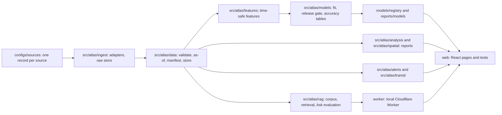

# Monsoon Atlas

A free map of Indian states that shows what is happening now, what models predict next, and how accurate past predictions were. Karnataka first, then Kerala, then Delhi.

The problem: public weather, rain, alert and price data for Indian states sits in many places with unclear licences, update times and history. This project records what each source supports, builds time-safe features from it, and tests whether a model beats a plain baseline before it is shown.

> Monsoon Atlas is an independent research project. It is not an emergency service and does not replace official information. In an emergency, contact the appropriate emergency service.

It reuses no name, logo, visual identity or text from KW Live.

## Status on 11 Nov 2026

Nothing is deployed. No demo URL exists, no public snapshot is approved, and the Karnataka MVP checklist says "not releasable" ([ka.md](docs/releases/ka.md)). Hosting waits for owner steps H05 and H06 and the release review H11 ([decision sheet](docs/releases/h11-ka.md)). Everything below runs on a local machine only.

| Model status | Models | Count |
|---|---|---|
| Measured (owner-approved champion, hindcast) | M05 | 1 |
| Research-only | M16 | 1 |
| Blocked at a recorded data gate | M01 to M04, M06 to M15, M17 to M20 | 18 |

M05 is the only model with an evaluated, owner-approved result. The other 19 have no accuracy number: M16 is counts only, and the 18 blocked models have no model at all. The index below gives each model's registry text and report.

| Area | State |
|---|---|
| Source records | 44 (26 available, 18 blocked); see [data licences](#data-licences) |
| Ask (cited answers) | Research-only (D101). Extractive answers with citations; no language model is connected (owner step H05). Its scores do not reproduce, see the lessons below. |
| Karnataka, Kerala, Delhi gate pages | [ka-v1.md](docs/releases/ka-v1.md), [kl.md](docs/releases/kl.md), [dl.md](docs/releases/dl.md) |
| Hosted service worker, offline cache | Not registered (D162) |

## The one measured result: M05 Karnataka drought outlook

Ridge regression forecasts district SPI-3 (a standardized three-month rainfall index) for the issue month, and the probability that SPI-3 is below -1. It is a **hindcast** (D39): IMD publishes its gridded rainfall yearly, so the issue-time availability the features assume was not real.

| Measure | Value | Source |
|---|---|---|
| Test window | 2020 to 2024, locked, 1800 district-months, 30 districts | [m05.md](reports/models/m05.md) |
| Strongest baseline | Persistence of SPI-3 | [v1.json](models/registry/M05/v1.json) |
| Error, ridge against persistence | MAE 0.732 against 0.808 | [v1.json](models/registry/M05/v1.json) |
| Improvement, paired block bootstrap | 0.076, 95% CI 0.003 to 0.150 | [v1.json](models/registry/M05/v1.json) |
| Unused 2025 check, provisional | MAE 0.625 against 0.744; the flag is "holds" | [m05-2025.md](reports/models/m05-2025.md) |
| 80% prediction intervals | Do not pass the 75% to 85% coverage gate (65% in v1, 72.8% after recalibration), so they are hidden | [m05-intervals.md](reports/models/m05-intervals.md) |

Limits: meteorological drought only, not groundwater or crop loss; drought probabilities run slightly high; the 2025 check covers 12 months, below the 24-month minimum for a release decision. The model card is [m05-card.md](reports/models/m05-card.md); the case study is [m05-case-study.md](reports/models/m05-case-study.md) (the owner's H14 rewrite is pending).

## Model index

Generated from the model registry and checked by `tests/test_portfolio.py` against `web/src/dashboards.json`. "Blocked" means a required source, label or history does not exist or cannot be used; the report states the gate and the retry condition. No blocked model has an accuracy number.

| ID | State | Task | Status | Reason (registry text) | Reports |
|---|---|---|---|---|---|
| M01 | ka | classification | blocked | M01 blocked: no official dated ward-level inundation records or audited negatives exist (S43, T085), so labels, features and flood probabilities cannot be built (T089). | [m01](reports/models/m01.md) |
| M02 | ka | regression | blocked | M02 blocked: no verified daily reservoir level or storage history (S28 KWRIS, T008), so labels, features and forecasts cannot be built (T092). | [m02](reports/models/m02.md) |
| M03 | ka | regression | blocked | M03 blocked: no verified daily reported reservoir inflow with units (S28 KWRIS, T008); inflow is never inferred from levels (T095). | [m03](reports/models/m03.md) |
| M04 | ka | regression | blocked | M04 blocked: no daily gauge rainfall with coordinates (S27 blocked, T077; S29 annual totals only, D113), so no gauge-day can be withheld (T098). | [m04](reports/models/m04.md) |
| M05 | ka | regression | champion, hindcast (D43) | Ridge beats persistence on the locked 2020 to 2024 test; hindcast. | [m05](reports/models/m05.md), [m05-card](reports/models/m05-card.md) |
| M06 | ka | classification | blocked | M06 blocked: verified Karnataka price history, price units and publication timing are required before implementing labels, features or predictions (T035). | [m06](reports/models/m06.md) |
| M07 | kl | regression | blocked | M07 blocked: a known vertical datum exists for 4 of the 8 dams the gate needs (D103, T129), S32 daily history is sampled dates only and S34 awaits the unapproved T118 bulk OCR, so labels, features and forecasts cannot be built (T130). | [m07](reports/models/m07.md) |
| M08 | kl | classification | blocked | M08 blocked: S35 is blocked and S36 holds 2018 district labels only, with no audited pre-2018 positives or negatives, so a forecasting classifier cannot be trained (T133). | [m08](reports/models/m08.md) |
| M09 | kl | classification | blocked | M09 blocked: S37 holds only state-level NRSC counts (no landslide point, date, positional error or survey footprint) and S42 imagery needs an unregistered account, so there is no label and no surveyed absence cell; the 200-landslide gate cannot pass (T136). | [m09](reports/models/m09.md) |
| M10 | kl | inference | blocked | M10 blocked: S22 exposes no price row and S23 is a one-day snapshot (5 Nov 2026) with an unverified price unit, so there is no weekly market-commodity panel, no 30-market sample and no 50 heavy-rain events; no effect can be estimated (T139). | [m10](reports/models/m10.md) |
| M11 | kl | classification | blocked | M11 blocked: it freezes the Karnataka flood model M01 and needs common Kerala flood labels, but M01 is blocked (S43 has no official dated ward-level inundation records, T085) and M08 is blocked (S35 is blocked and S36 holds 2018 district tables only), so there is no frozen Karnataka score, no common 2023-24 labels and no 30 Kerala flood events (T170). | [m11](reports/models/m11.md) |
| M12 | dl | regression | blocked | M12 blocked: S38 is blocked on owner step H04 (D135), so no static GTFS, real-time sample or trip linkage was read and there are 0 vehicle positions and 0 service days; a scheduled-delay label cannot be built and no arrival or delay can be predicted (T153). | [m12](reports/models/m12.md) |
| M13 | dl | classification | blocked | M13 blocked: S38 is blocked on owner step H04 (D135), so there are 0 completed trajectories, 0 service days and no verified scheduled headways; bunching cannot be labelled and no flag or persistence forecast can be made (T156). | [m13](reports/models/m13.md) |
| M14 | dl | regression | blocked | M14 blocked: S24 CPCB station data is blocked (D133, D134): resource ID, licence, fields, units, averaging interval and history are unread and there are 0 station rows, so no PM2.5 label exists; S04 CAMS is a model estimate and baseline input, never a label (T159). | [m14](reports/models/m14.md) |
| M15 | dl | regression | blocked | M15 blocked: no Delhi source is enabled, S01 keeps no issue-time forecast vintages (D07) so no forecast is matched to observed truth, S02 is ERA5 reanalysis, which supports trends and exposure only, and S18 impervious inputs are blocked by robots.txt; calibration skill cannot be claimed (T162). | [m15](reports/models/m15.md) |
| M16 | all | anomaly | research_only | M16 is research-only: the rule runs on the held S08 daily grids and flag counts are reported (reports/models/m16-flag-counts.json), but 0 of 100 flags are adjudicated (T212, T213 blocked, D159), so precision is not measured and no quality claim is made. S22 and S23 hold zero price rows and S32 has no 28-day window. No IsolationForest challenger was run. | [m16](reports/models/m16.md) |
| M17 | kl | segmentation | blocked | M17 blocked: S42 Sentinel-1 imagery needs a Copernicus account (proposed owner step H15), so no scene was read, and no independent inundation masks exist (S35 is blocked, S36 holds 2018 district tables and S43 has no official impact labels), so there are not 5 distinct labelled events; training would also need a Kaggle or Colab GPU, not the 2 GB local card (T173). | [m17](reports/models/m17.md) |
| M18 | kl | classification | blocked | M18 blocked: S41 is blocked (T125, no publisher permission to store or classify items), so there are 0 permitted articles; the twenty annotation batches T189 to T208 are recorded as blocked (D155) with 0 articles selected, 0 labelled and 0 owner-reviewed, and owner step H13 has not happened; the gate needs 1000 permitted annotated texts (T209). | [m18](reports/models/m18.md) |
| M19 | ka | regression | blocked | M19 blocked: it must beat the M02 baseline on the same reservoir level target, and M02 is blocked because S28 KWRIS has no verified daily reservoir level history (T092), so there are no reservoirs with 5 years of daily data, no M02 baseline and no target; no free GPU session exists either, as the Kaggle owner step H10 is open (T167). | [m19](reports/models/m19.md) |
| M20 | all | scenario | blocked | M20 blocked: it recomputes an already-approved flood score from the exact M01 or M08 input snapshot, and neither is approved: M01 is blocked (S43 has no labels, T085) and M08 is blocked (S35 is blocked and S36 holds 2018 district tables only). M05 is the only approved model and is a drought model, so it is not a base; the controls stay disabled (T176). | [m20](reports/models/m20.md) |

## What can be shown locally today

Run the dev server (see [reproduce](#reproduce)) and open these pages:

| Page | Shows |
|---|---|
| `?page=accuracy` | Model accuracy table; M05 with its hindcast label, the others as unavailable |
| `?page=quality` | Source health, the unadjudicated anomaly queue and the M05 drift check |
| `?page=analysis` | Analysis reports, with the restricted sources marked |
| `?page=compare` | State comparison: source and model counts for Karnataka, Kerala and Delhi side by side; a metric comparison only where one is valid, otherwise the reason it is unavailable |
| `?page=ask` | Research-only Ask; needs a local corpus release |
| `?page=widget` | Read-only widget (T218) |

Built and tested, but not mounted on a page or not registered (waiting for H11): the Kerala 2018 replay, route comparison, Delhi transit and air components, terrain and globe, movement overlays, wall mode, watches, and the offline service worker. Without a local snapshot the home map says "No released snapshot yet". The 3-minute demo is a script only and is not recorded: [video.md](docs/portfolio/video.md).

## Architecture



Design choices: every row carries `available_at` and `valid_at`, and a feature may only use rows known at issue time (D37); a disabled source raises `SourceUnavailable` and never returns synthetic rows; official alerts, model outputs and inferred items stay visibly separate; a model is promoted only if the lower 95% paired bootstrap bound of its improvement is above 0 (D38). Cost is Rs 0: free tiers and open data only, no card on file (`scripts/audit_dependencies.py --policy` checks the dependency policy). No personal data, accounts or subscriber lists are kept.

## Failed-model lessons

These are findings, not achievements. Each one points to the file that records it.

- **Check the data before the model.** 18 of 20 models are blocked because a source, label or history does not exist or cannot be stored (for example M07: a known vertical datum exists for 4 of the 8 dams the gate needs; M08: 2018 district labels only). The gates were recorded early ([core data gate](docs/gates/core_data_gate.md), D17, D29), so the core drought model became M05, which had the data, instead of failing after weeks of training.
- **Be honest about vintage.** M05 is a hindcast because the rain files arrive yearly (D39). M15 is blocked partly because S01 keeps no issue-time forecast vintages (D07). A hindcast is never described as a forecast that was available then.
- **Labels must be independent of the rule.** M16 flags are counts only: 0 of 100 flags are adjudicated, so precision is not measured ([m16.md](reports/models/m16.md)). Flag counts are not accuracy.
- **A rule has to suit the data.** On the held daily rain grids the M16 rule gives no z-score for 6,644,980 of 8,875,440 Karnataka cell-days because the median absolute deviation is 0, and flags 417,948 others, mostly in the monsoon; many are probably ordinary heavy rain ([m16.md](reports/models/m16.md)).
- **A better point forecast is not calibrated uncertainty.** The M05 intervals under-cover on the locked test, and recalibrating on pre-test years still left coverage below the gate; the test years had already been used once for intervals, which the report says ([m05-intervals.md](reports/models/m05-intervals.md)).
- **Scores drift when the corpus grows.** The committed Ask scores of 8 Nov 2026 are correctness 0.89 and evidence support 0.86 against a 0.95 gate ([rag.md](reports/rag.md)). A re-run on 11 Nov 2026 gave 0.84 and 0.80 as the indexed documents and logs grew; the cause was not investigated and Ask stays research-only (D147). Project documents, including this README, are part of that corpus, so any documentation change can move the scores again.

## Reproduce

Windows 10, PowerShell, Python 3.12 only (never 3.14), DuckDB 1.x only. Everything stays on drive D (D26). Locks are in `requirements/`: core and dev are enough for the tests below; geo, ml, dl and ocr are optional groups.

```powershell
python -m pip install --require-hashes -r requirements/core.txt
python -m pip install --require-hashes -r requirements/dev.txt
python -m pip install --no-deps -e .
.\.venv\Scripts\python -m pytest -q
.\.venv\Scripts\python -m ruff check .
.\.venv\Scripts\python -m ruff format --check .
.\.venv\Scripts\python scripts/audit_dependencies.py --policy
```

Local map (pinned Node toolchain under `.tools/node/`, see [web shell](docs/web-shell.md)):

```powershell
powershell -NoProfile -File scripts/web.ps1 ci --ignore-scripts
powershell -NoProfile -File scripts/web.ps1 run dev
```

Regenerate committed reports from committed records:

```powershell
.\.venv\Scripts\python -m atlas.models.accuracy   # docs/releases/ka.md and web/src/dashboards.json
.\.venv\Scripts\python -m atlas.rag.evaluate      # reports/rag.md, for Ask
```

The M05 release itself (`scripts/m05_release.py`) needs the IMD and district raw files, which are local only and never committed. Re-running it reads data this repository does not hold.

## Data licences

One row per source record in `configs/sources/`. "Available" means the discovery check found access, licence and history on stored pages (D27); it does not mean the source is enabled in a state config or that a model uses it. The code is MIT licensed ([LICENSE](LICENSE)); each dataset keeps its own licence and attribution terms.

- **open:** the provider states an open licence; attribution follows the record.
- **restricted:** redistribution is limited. Only derived outputs are published, or nothing; raw values stay in `data/raw` and are never committed. IMD rainfall (S08) is the main case: only derived indices and model results, with the citation.
- **unverified:** the licence for the data itself is missing, unreadable or unconfirmed, so the source stays disabled.

| ID | Source | Discovery state | Licence status | Outcome | Record |
|---|---|---|---|---|---|
| S01 | Open-Meteo weather forecast | ka | open | available | [s01.yaml](configs/sources/s01.yaml) |
| S02 | Open-Meteo historical weather / ERA5 | ka | open | available | [s02.yaml](configs/sources/s02.yaml) |
| S03 | Open-Meteo GloFAS river discharge | ka | open | available | [s03.yaml](configs/sources/s03.yaml) |
| S04 | Open-Meteo CAMS air-quality estimates | ka | open | available | [s04.yaml](configs/sources/s04.yaml) |
| S05 | Open-Meteo ensemble | ka | open | available | [s05.yaml](configs/sources/s05.yaml) |
| S06 | Open-Meteo climate projections | ka | open | available | [s06.yaml](configs/sources/s06.yaml) |
| S07 | NASA POWER daily point | ka | open | available | [s07.yaml](configs/sources/s07.yaml) |
| S08 | IMD Pune gridded rainfall 1901-2024 | ka | restricted | available | [s08.yaml](configs/sources/s08.yaml) |
| S09 | NDMA Sachet CAP alerts | ka | open | available | [s09.yaml](configs/sources/s09.yaml) |
| S10 | adsb.lol live aircraft | ka | open | available | [s10.yaml](configs/sources/s10.yaml) |
| S11 | OpenSky flight fallback | ka | unverified | blocked | [s11.yaml](configs/sources/s11.yaml) |
| S12 | CelesTrak orbit elements | ka | restricted | available | [s12.yaml](configs/sources/s12.yaml) |
| S13 | NASA GIBS satellite imagery | ka | open | available | [s13.yaml](configs/sources/s13.yaml) |
| S14 | AWS Terrarium terrain | ka | open | available | [s14.yaml](configs/sources/s14.yaml) |
| S15 | OpenFreeMap basemap | ka | open | available | [s15.yaml](configs/sources/s15.yaml) |
| S16 | WorldPop India population | ka | open | available | [s16.yaml](configs/sources/s16.yaml) |
| S17 | geoBoundaries administrative boundaries | ka | open | available | [s17.yaml](configs/sources/s17.yaml) |
| S18 | Geofabrik OSM extracts | ka | open | blocked | [s18.yaml](configs/sources/s18.yaml) |
| S19 | Google Open Buildings | ka | open | available | [s19.yaml](configs/sources/s19.yaml) |
| S20 | USGS earthquakes | ka | restricted | available | [s20.yaml](configs/sources/s20.yaml) |
| S21 | Datameet railway schedules | ka | open | available | [s21.yaml](configs/sources/s21.yaml) |
| S22 | India Data Portal Agmarknet / existing price data | ka | unverified | blocked | [s22.yaml](configs/sources/s22.yaml) |
| S23 | data.gov.in mandi prices | ka | open | blocked | [s23.yaml](configs/sources/s23.yaml) |
| S24 | CPCB station pollution via data.gov.in | dl | unverified | blocked | [s24.yaml](configs/sources/s24.yaml) |
| S25 | NASA FIRMS active fires | ka | open | blocked | [s25.yaml](configs/sources/s25.yaml) |
| S26 | aisstream ships | kl | unverified | blocked | [s26.yaml](configs/sources/s26.yaml) |
| S27 | KSNDMC gauges | ka | unverified | blocked | [s27.yaml](configs/sources/s27.yaml) |
| S28 | KWRIS reservoirs and rainfall | ka | restricted | blocked | [s28.yaml](configs/sources/s28.yaml) |
| S29 | OpenCity KSNDMC hobli rainfall | ka | open | available | [s29.yaml](configs/sources/s29.yaml) |
| S30 | BMTC and Namma Metro static GTFS | ka | restricted | available | [s30.yaml](configs/sources/s30.yaml) |
| S31 | Karnataka RERA projects | ka | restricted | blocked | [s31.yaml](configs/sources/s31.yaml) |
| S32 | KSEB daily water level | kl | open | available | [s32.yaml](configs/sources/s32.yaml) |
| S33 | KSEB monthly dam statistics | kl | unverified | blocked | [s33.yaml](configs/sources/s33.yaml) |
| S34 | KSDMA dam level reports | kl | restricted | available | [s34.yaml](configs/sources/s34.yaml) |
| S35 | Kerala 2018 flood dataset | kl | unverified | blocked | [s35.yaml](configs/sources/s35.yaml) |
| S36 | KSDMA post-disaster assessment | kl | restricted | available | [s36.yaml](configs/sources/s36.yaml) |
| S37 | 2018 landslide inventory / ISRO Atlas | kl | restricted | blocked | [s37.yaml](configs/sources/s37.yaml) |
| S38 | Delhi Open Transit Data | dl | restricted | blocked | [s38.yaml](configs/sources/s38.yaml) |
| S39 | Telegram Bot API | ka | restricted | blocked | [s39.yaml](configs/sources/s39.yaml) |
| S40 | Ward / taluk polygons and crosswalks | ka | open | available | [s40.yaml](configs/sources/s40.yaml) |
| S41 | Permitted news RSS sources | kl | restricted | blocked | [s41.yaml](configs/sources/s41.yaml) |
| S42 | Sentinel-1 / NDVI quantitative imagery | kl | open | blocked | [s42.yaml](configs/sources/s42.yaml) |
| S43 | Official shelters and flood impact labels | ka | unverified | blocked | [s43.yaml](configs/sources/s43.yaml) |
| S44 | District crime statistics | ka | open | available | [s44.yaml](configs/sources/s44.yaml) |

## Limitations

- One model has a measured result, and it is a hindcast on district boundaries, not taluks.
- No model output is live: no model serves predictions, and no prediction ledger exists yet.
- The 80% intervals are hidden because they do not meet their coverage gate.
- Ask has no language model and its scores do not reproduce; Kannada, Malayalam and Hindi question drafts are machine drafts, unreviewed and not scored.
- Many sources are blocked or restricted, so Kerala and Delhi have descriptive views and gates, not models.
- Official alerts, model outputs and inferred items are different things. No route or area is promised safe.
- The Power BI project ([MonsoonAtlas.pbip](powerbi/MonsoonAtlas.pbip)) has not been opened in Power BI Desktop and has no exports. The SQL findings are in [sql_insights.md](reports/sql_insights.md).

## Owner steps still pending

- H05 and H06: free Cloudflare and Hugging Face accounts and tokens, before any hosting or language-model use.
- H11: the release review for the Karnataka MVP ([h11-ka.md](docs/releases/h11-ka.md)).
- H14: read each core case study and rewrite its summary in your own words.
- Record the demo video ([video.md](docs/portfolio/video.md)).
- Data retries listed per model in the index and in [ka-v1.md](docs/releases/ka-v1.md), for example adjudicating 100 M16 flags.

## Portfolio documents

- [Case-study template](docs/case-studies/template.md) and the existing case studies for [M05](reports/models/m05-case-study.md), [M07](reports/models/m07-case-study.md) and [Ask](reports/models/ask-case-study.md) (the Ask one quotes the 8 Nov scores above)
- [Demo video script](docs/portfolio/video.md), [resume lines](docs/portfolio/resume.md), [glossary](docs/glossary.md)

## Documents

- [Plan](docs/plan.pdf): full planning handover (tasks, model cards, data sources)
- [Amendments v1](docs/amendments.md): changes to the plan; these win where they conflict
- [Decisions log](docs/decisions.md) and [current handoff](docs/HANDOFF.md)
- [Agent rules](AGENTS.md)
- Hosting preparation: [local Worker](docs/worker.md); [owner account steps](docs/account-setup.md); [rollback runbook](docs/runbooks/rollback.md)
- Place reports: [frozen links and print/PDF](docs/web-lens.md)
- Background: [research notes](docs/research/kw-live-and-india-data-research.md), [planning PDFs](docs/planning/)

## Licence

Original code is MIT licensed (see [LICENSE](LICENSE)). Each dataset keeps its own licence and attribution terms.
